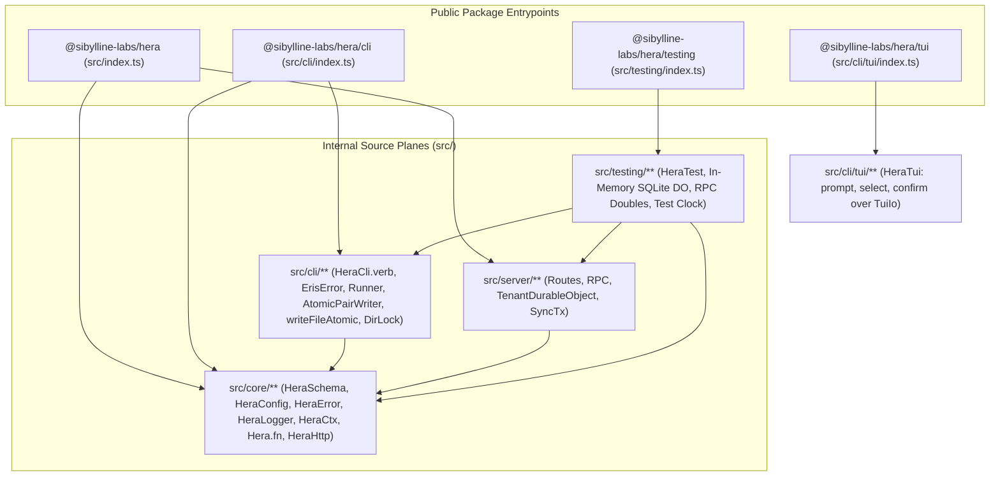
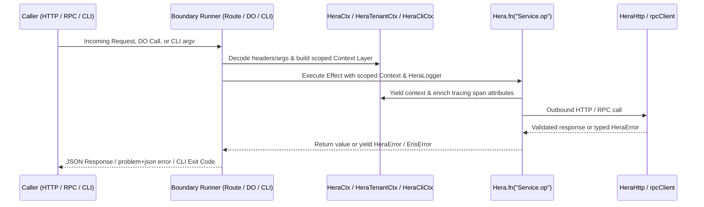

# Architecture & Plane Isolation

`@sibylline-labs/hera` is the shared Effect v4 LTS runtime spine across both Cloudflare Worker services and standalone developer/CI CLIs (eris is one). Because one SDK serves both edge V8 isolates (`cloudflare:workers`) and standalone compiled CLI binaries (`bun build --compile`), strict plane isolation is the primary architectural invariant of the repository. Product wire contracts (versioned cross-service schemas) are not a plane: they live in their own package, which takes Hera as a peer dependency.

---

## The Four Planes

### Dependency Rules

1. **`src/core/`** depends only on `effect`, and Web Standard APIs (`fetch`, `Response`, `crypto.subtle`, `AbortController`). It never imports from `src/server/`, `src/cli/`, or `src/testing/`.
2. **`src/server/`** depends on `src/core/`. It never imports from `src/cli/` or `src/testing/`, guaranteeing zero Node-only builtin leakage (`node:child_process`, `node:fs`) into Cloudflare Worker bundles.
3. **`src/cli/`** depends on `src/core/` and Node/Bun runtime builtins (`node:child_process`, `node:fs`, `node:os`, `node:path`). It never imports from `src/server/` or `src/testing/`, so `bun build --compile` produces standalone CLI binaries with zero `cloudflare:workers` imports.
   - **`src/cli/tui/`** is the exception inside the CLI plane: it imports only its own siblings (no `effect`, no `node:*`, no other plane) and nothing in `src/` imports it, so `@sibylline-labs/hera/cli` never loads it and public eris vendors it flat. [`rules/ast-grep/hera-tui-vendorable.yml`](../rules/ast-grep/hera-tui-vendorable.yml) and [`rules/ast-grep/hera-tui-lazy.yml`](../rules/ast-grep/hera-tui-lazy.yml) hold both halves, and [`test/tui-cold-start.test.ts`](../test/tui-cold-start.test.ts) measures them against the CLI's 50ms budget.
4. **`src/testing/`** provides test utilities across all planes and is imported only by `test/**` or downstream consumer test suites via `@sibylline-labs/hera/testing`.

These boundaries are continuously enforced by [`test/hygiene/repo-layout.test.ts`](../test/hygiene/repo-layout.test.ts) and [`test/cold-start.test.ts`](../test/cold-start.test.ts).

---

## Compile-Time Auth & Tenancy Progression

Hera splits ambient request context into distinct `Context.Service` tags (`src/core/context/`):

- **`HeraPublicCtx`**: `{ requestId, service, logger, now }` — provided by `Hera.publicRoute`.
- **`HeraAuthedCtx`**: `{ ...HeraPublicCtx, orgId, actorId, actorKind, scopes, productCtx }` — provided to authenticated handlers.
- **`HeraTenantCtx`**: `{ orgId, requestId, actorId, actorKind, scopes, service, db, logger, scheduleDomainAlarm, now }` — provided by `Hera.authedRoute` / `Hera.tenantRoute` and `TenantDurableObject.runWithTenantCtx`.

Because `Hera.publicRoute` only provides `HeraPublicRouteEnv` (`HeraPublicCtx | HeraCtx | HeraLoggerService`), passing a `Hera.fn` that yields `HeraAuthedCtx` or `HeraTenantCtx` into `Hera.publicRoute` fails at TypeScript compile time.

---

## Request & Invocation Lifecycle

### Why Boundary-Only `Effect.run*`?

Running an Effect via `Effect.runPromise` or `Effect.runSync` inside domain logic drops ambient context layers (`HeraTenantCtx`, `HeraLoggerService`), breaks span hierarchy and fiber cancellation, and bypasses boundary error sanitization.

[`rules/ast-grep/hera-no-raw-effect-run.yml`](../rules/ast-grep/hera-no-raw-effect-run.yml) bans raw `Effect.run*` calls everywhere except the framework boundary runners:
- `src/server/routes/` (HTTP route boundaries)
- `src/server/rpc/` (Worker RPC boundaries)
- `src/server/durable-object/` (Durable Object lifecycle & alarm boundaries)
- `src/cli/runtime/` (`HeraCli.verb` entry boundary)
- `src/testing/runner/` (`HeraTest.runTest` boundary)
